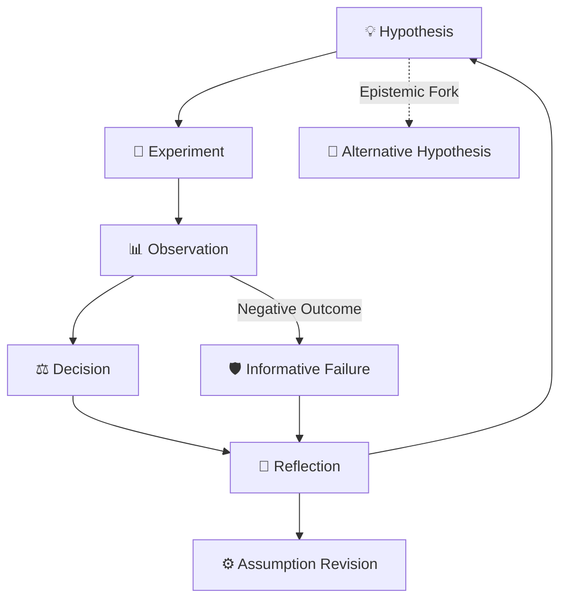

# RAE-CRL (Cognitive Research Loop)

**Scientific Research Overlay for Reflective Agentic Engine**

> **License:** Apache 2.0  
> **Status:** Research Preview / Early Access  
> **Core Dependency:** [RAE-Suite](https://github.com/vproject111/RAE-Suite) (agnostic memory & reasoning engine)  
> **Target Audience:** Researchers, PhD students, and Autonomous AI Research Agents (e.g. Hermes, Claude, Cursor)

---

## 1. Introduction

**RAE-CRL** is an epistemic scaffolding system designed for researchers working in high-complexity, long-duration experimental environments. Operating as a domain-agnostic scientific overlay on top of the RAE (Reflective Agentic Engine), it preserves the **continuity of scientific reasoning** across months and years of investigation.

Unlike traditional Electronic Lab Notebooks (ELN) which catalog raw data, or Project Management tools which track task checklists, RAE-CRL focuses on **epistemic continuity**:
- *Why* a parameter was changed 6 months ago.
- *How* hypotheses evolved across failed attempts.
- *What* assumptions turned out to be false and why.
- *How* failed experiments become high-value informative assets rather than deleted noise.

### Key Characteristics

*   **Domain Agnostic:** Bioengineering, Material Science, Physics, Chemistry, AI/ML, and Computer Science. No domain logic is hardcoded.
*   **Offline-First & Local:** Designed for air-gapped labs, field workstations, and sovereign data ownership.
*   **Decision-Centric & Failure-Aware:** Treats "Decisions", "Reflections", and "Informative Failures" (`FAILED_BUT_INFORMATIVE`) as first-class citizens.
*   **Human-Centric Grace Period:** 24-hour private quarantine for raw epistemic traces before public or team synchronization.
*   **Agent-Native (FastMCP):** AI agents (like Hermes) can take notes, propose forks, and log experimental results directly through standard MCP tools.
*   **Deterministic Core:** Fully functional with local SQLite storage; enhanced with semantic vector resonance when paired with RAE-Suite.

---

## 2. The 6 Scientific Artifacts & Human-Centric Extensions

RAE-CRL structures the cognitive research process through formalized artifacts:

| Artifact | Purpose | Example |
| :--- | :--- | :--- |
| **`Hypothesis`** | Testable prediction or theoretical claim | *"Doping PET-G with 2% graphene will increase tensile strength by >15%"* |
| **`Assumption`** | Underlying axioms or calibration constraints | *"Spectrometer calibration is accurate to ±0.2 nm"* |
| **`Experiment`** | Reproducible protocol and execution run | *"Tensile stress cycle test ASTM D638, strain rate 5 mm/min"* |
| **`Observation`** | Empirical logs, measurements, or raw output | *"Sample fractured at 48.2 MPa with brittle crack propagation"* |
| **`Decision`** | Architectural choice or protocol pivot | *"Abandoning 1% doping, proceeding with 2% and 3% concentration"* |
| **`Reflection`** | Meta-cognitive analysis of experimental outcomes | *"Thermal annealing before pulling is required to reduce micro-voids"* |

### Human-Centric & Epistemic Extensions

1. **Epistemic Trace (`quick_note`)**: Rapid capture of thoughts, doubts, or lab observations with a 24-hour grace period (private drafts).
2. **Epistemic Fork (`fork_artifact`)**: Branching an artifact when team members or agents propose competing interpretations of the same observation (`has_alternative_interpretation`).
3. **Informative Failure (`record_failure`)**: Tags experiments as `FAILED_BUT_INFORMATIVE` with causal rationale, preventing redundant wasted efforts.
4. **PI Governance (`request_approval` / `approve_artifact`)**: Formal review flow for principal investigators before syncing to public layers.

---

## 3. The Cognitive Research Loop

Research is non-linear; RAE-CRL models it as a bidirectional epistemic graph:



---

## 4. Quickstart & Installation

### Requirements
- **Python**: 3.10 – 3.12 (Python 3.12 recommended)
- **Package Manager**: `uv` (recommended) or standard `pip`
- **Optional**: RAE-Suite running on `http://localhost:8000` (for semantic memory sync)

### Setup with `uv`

```bash
# 1. Clone repository
git clone https://github.com/vproject111/RAE-CRL.git
cd RAE-CRL

# 2. Create Python 3.12 venv and install dependencies
uv venv --python 3.12 .venv
source .venv/bin/activate
uv pip install -r requirements.txt

# 3. Initialize local SQLite database
python -c "import asyncio; from apps.crl.core.database import init_db; asyncio.run(init_db())"
```

---

## 5. Usage Interfaces

RAE-CRL provides four complementary interfaces:

### A. Web Lab Desk (Interactive GUI)

Launch the NiceGUI interactive lab desk:

```bash
# Run headless / network server (accessible on http://localhost:8503 or across LAN/Tailscale)
python run_server.py
```

*Features*: High-contrast WCGA mode, visual graph exploration, instant trace logging, and report export.

### B. FastMCP Server for AI Agents (Hermes, Claude, Cursor)

RAE-CRL includes a native FastMCP server (`apps/crl/mcp_server.py`) exposing scientific tools:

```bash
python apps/crl/mcp_server.py
```

**MCP Configuration (`mcp.json`):**
```json
{
  "mcpServers": {
    "rae-crl": {
      "command": "/path/to/RAE-CRL/.venv/bin/python",
      "args": ["/path/to/RAE-CRL/apps/crl/mcp_server.py"],
      "env": {
        "RAE_CORE_URL": "http://localhost:8000",
        "DATABASE_URL": "sqlite+aiosqlite:///rae_crl.db"
      }
    }
  }
}
```

*Tools provided to the Agent*:
- `quick_note`: Capture ideas in 24h grace period.
- `refine_artifact`: Promote notes to formal Hypotheses/Experiments.
- `record_failure`: Retain negative experimental knowledge.
- `fork_artifact`: Branch epistemological interpretations.
- `list_my_traces`: View pending research tasks.
- `request_approval` / `approve_artifact`: Principal Investigator review.

### C. CLI Interface

```bash
# Initialize a new research context
rae-crl init "superconductivity-study"

# Add hypothesis
rae-crl add hypothesis "Hydride doping reduces critical magnetic field threshold" "Full synthesis protocol A" "superconductivity-study"

# Add experiment
rae-crl add experiment "SQUID magnetometry measurement at 4.2K" "Field sweep from 0 to 7T" "superconductivity-study"

# Semantic search over research history
rae-crl query "magnetic field threshold" "superconductivity-study"
```

---

## 6. Guides & Integration

- 📘 **[PhD Student & AI Agent Guide (Przewodnik dla Kubusia i Hermesa)](./docs/guides/KUBUS_HERMES_GUIDE.md)**: Detailed step-by-step workflow in Polish for academic research, automated test generation, and SonarQube verification.
- 🔬 **[RAE-Suite Memory Integration](https://github.com/vproject111/RAE-Suite)**: Connect RAE-CRL to Qdrant vector memory and multi-node compute clusters (RTX 4080 / Lumina).

---

## 7. Testing & Quality Assurance

```bash
# Run unit and integration tests with coverage
pytest --cov=apps tests/
```

SonarQube Quality Gates apply (0 Bugs, 0 Vulnerabilities, 0 Code Smells, Coverage >90%).
